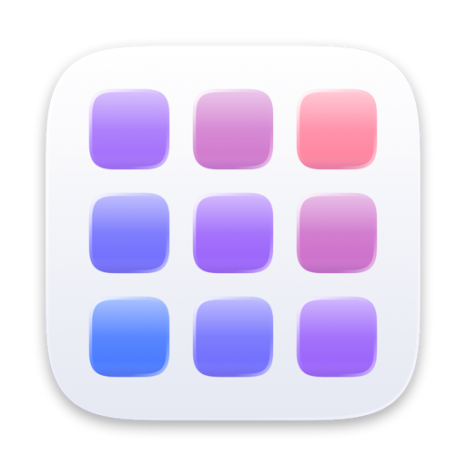

<p align="center">
  <picture>
    <source media="(prefers-color-scheme: dark)" srcset="website/assets/icon-dark.png">
    
  </picture>
</p>

<h1 align="center">Relaunch</h1>

<p align="center">
  <a href="https://github.com/STACK-42/relaunch/actions/workflows/ci.yml"></a>
  <a href="https://github.com/STACK-42/relaunch/releases/latest"></a>
  
  <a href="LICENSE"></a>
</p>

A full-screen, paged app launcher for macOS 14 and later. It brings back the
grid you swipe left and right that Launchpad used to provide, including
folders, drag to rearrange, search, and page dots.

On first run it **restores your old Launchpad layout** from the database
macOS left on disk. See [docs/RESEARCH.md](docs/RESEARCH.md) for how Apple's
version worked and what replaced it.

> Not affiliated with or endorsed by Apple Inc. "Launchpad" and "macOS" are
> trademarks of Apple Inc. Relaunch contains no Apple code or artwork; the
> website screenshots show the apps installed on the author's Mac.

## Install

Requires macOS 14 Sonoma or later. The first two options are Apple silicon builds.

**Download:** get [Relaunch.dmg](https://github.com/STACK-42/relaunch/releases/latest/download/Relaunch.dmg),
open it and drag Relaunch to Applications. The app isn't notarized yet, so if
macOS refuses to open it, go to System Settings → Privacy & Security → Open Anyway.

**Terminal:** downloads the latest release, verifies its SHA-256 checksum,
installs it and opens it ([read the script](scripts/install.sh)):

```sh
curl -fsSL https://relaunch.stack42.tech/install.sh | bash
curl -fsSL https://relaunch.stack42.tech/install.sh | bash -s -- --uninstall   # remove
```

**Build it yourself** (also works on Intel). Needs only the Xcode Command
Line Tools (`xcode-select --install`):

```sh
scripts/build.sh            # builds build/Relaunch.app
scripts/build.sh --install  # also copies it to /Applications
scripts/package.sh          # builds dist/Relaunch.dmg and .zip with checksums
```

Drag `Relaunch.app` into the Dock. Clicking it opens and closes the launcher,
like Launchpad's Dock tile.

## If macOS won't open it

Releases aren't notarized by Apple yet, so a browser-downloaded copy may show
*"Apple could not verify 'Relaunch' is free of malware"*. Any one of these works:

- **Open Anyway:** try to open it once, then go to System Settings → Privacy &
  Security, and under Security click **Open Anyway**.
- **Install from Terminal** with the command above. Terminal downloads aren't
  flagged as coming from the internet, so there's no warning.
- **Clear the flag** on a copy you already have:
  `xattr -dr com.apple.quarantine /Applications/Relaunch.app`

## The pinch gesture

Pinch with your thumb and three fingers to open Relaunch, and spread them to
close it, like Launchpad. No extra apps or permissions are needed.

macOS uses the same pinch for its own Apps view, and the **Apps** switch in
System Settings → Trackpad → More Gestures doesn't turn off on current macOS.
So the first time you open Relaunch, it asks whether to turn off macOS's pinch
for you. Say yes and the pinch opens only Relaunch. Apple's Apps view is still
one ⌘Space away.

- Turning off macOS's pinch also turns off its spread to show the desktop.
  Relaunch does that part itself: spread while Relaunch is closed and the
  desktop shows.
- Change your mind any time: right-click the Relaunch background and toggle
  **Pinch Opens Only Relaunch**.
- If System Settings was already open, it keeps showing the old state of the
  **Apps** switch until you quit and reopen it.

## Update or uninstall

Relaunch runs in the background, so it has no Quit in the Dock or menu bar.
Everything is in the menu you get by right-clicking the Relaunch background.

**Update:** right-click the background → **Quit Relaunch**, then drag the new
version into Applications and replace the old one. Your layout and settings
stay. The Terminal install command does all of this for you.

**Uninstall:** right-click the background → **Uninstall Relaunch…**. It turns
macOS's own pinch back on (if Relaunch turned it off), removes the login item,
the layout and the settings, and moves the app to the Trash. From Terminal:

```sh
curl -fsSL https://relaunch.stack42.tech/install.sh | bash -s -- --uninstall
```

Installing again later starts fresh, like the first time, and can bring back
your Launchpad layout again.

**Already deleted it by hand?** Turn macOS's pinch back on in System Settings →
Trackpad → More Gestures → **Apps**, and remove Relaunch from your Dock.

## Using it

| Action | How |
| --- | --- |
| Open / close | Pinch / spread thumb and three fingers, Dock icon, **⌥Space**, or a hot corner (see Settings) |
| Change page | Two-finger swipe, mouse wheel, ⌘← / ⌘→, or click a page dot |
| Search | Just type. Matches prefixes, words, initials (`vsc`) and ignores accents |
| Launch | Click, or arrow keys then Return |
| Rearrange | Drag an icon. Hold it at a screen edge to change page |
| Make a folder | Drop an app onto another app and hold briefly |
| Rename a folder | Open it and click the title |
| Leave a folder | Drag the app out of the panel |
| Edit mode (jiggle) | Hold ⌥ |
| Close | Esc, click empty space, ⌘W |
| More | Right-click the background: Open at Login, Pinch Opens Only Relaunch, Restore Launchpad Layout, Reset, Quit, Uninstall |

## Settings

```sh
defaults write com.ahmedalghali.Relaunch hotkey "ctrl+opt+l"   # "" disables it
defaults write com.ahmedalghali.Relaunch hotCorner bottomLeft  # topLeft|topRight|bottomLeft|bottomRight
defaults write com.ahmedalghali.Relaunch columns -int 8        # default 7
defaults write com.ahmedalghali.Relaunch rows -int 6           # default 5
defaults write com.ahmedalghali.Relaunch pinch -bool false     # stop watching the trackpad pinch
defaults write com.ahmedalghali.Relaunch openAtLogin -bool false
```

Restart Relaunch after changing settings. The layout is stored in
`~/Library/Application Support/Relaunch/layout.json`.

## Performance

Measured on an Apple-silicon MacBook running macOS 27.0, with 115 apps:

- **Startup:** app discovery takes about 50 ms. Icons render to bitmaps in
  parallel in the background.
- **Opening:** the process stays resident and the window is built once, so
  opening is a single frame followed by a 0.24 s zoom-and-fade. Launchpad got
  the same effect by living inside the Dock.
- **Paging:** the finger offset lives in its own observable object, so a
  swipe re-renders only the view that applies the translation, not the grid.
  Dragging works the same way: cursor motion redraws only the floating icon.
- **Idle:** 0 % CPU, about 100–145 MB resident, 0.9 MB binary.
- **No permissions:** the hotkey uses Carbon `RegisterEventHotKey`, hot
  corners use mouse-move monitors, and the pinch reads raw trackpad touches
  from MultitouchSupport, so Accessibility access isn't needed.

## How it differs from Launchpad

- Restores your Launchpad pages and folders automatically.
- Search is more forgiving: word prefixes, initials and accent-insensitive.
- New folders are named after the apps' App Store category.
- Folders can be ungrouped in one step (right-click).
- Liquid Glass on macOS 26+, materials on 14–15.
- Install and uninstall are detected live.

**Limitation:** the F4 key stays with the system, because the Dock captures
it (see the research notes). The pinch works once macOS's own pinch is off.

## License

MIT. See [LICENSE](LICENSE).
